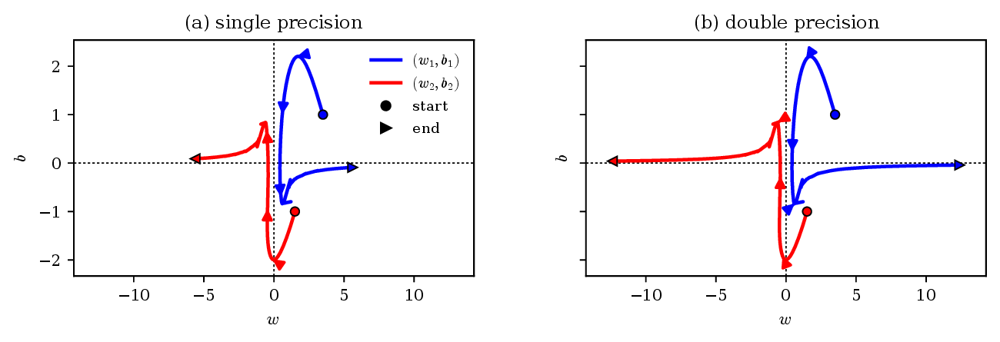
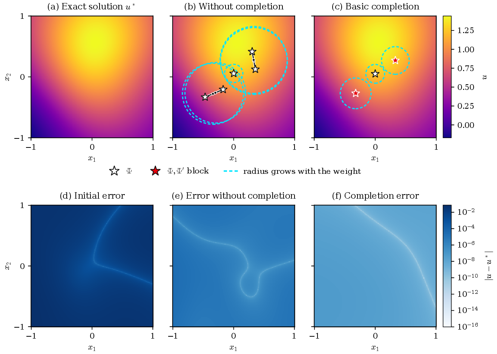
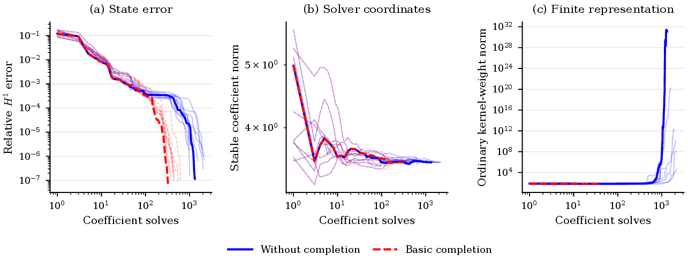

# Singular Parameters and Missing Limits in Neural PDE Solvers

**Daniel Fernández · Enrique Zuazua**

[Experiments](#the-experiments) · [Reproduce the results](REPRODUCING.md) · [All paper figures](figures/paper/) · [Citation](CITATION.cff)

A neural PDE approximation can become more accurate while its parameters grow without bound. At fixed width, the limiting solution may be smooth and still lie outside the neural model's realization class.

This paper connects that behaviour to the **closure of the neural parametrisation class**. For deep tanh networks, approaching a missing limit forces parameter escape or hidden-layer degeneracy. For one-dimensional translated-feature models, we characterise the closure through kernel derivatives, counted within the original width. Admitting these limits—**completion**—restores variational attainment under the stated assumptions and provides stable coordinates for computation.

<p align="center">
  
</p>

*Figure 3. Colliding features approach a missing state. Completion represents that state using the kernel and its derivatives.*

## The experiments

The repository contains the four numerical studies in the paper, their reported appendix checks, and the three analytical illustrations. Every figure below is the current publication figure.

| Section | Question | Figures | Code and records |
| --- | --- | --- | --- |
| 4.1 | What happens to parameters as two tanh neurons approach a missing limit? | [4](figures/paper/figure_04.pdf), [5](figures/paper/figure_05.pdf) | [Tanh experiments](docs/experiments_tanh_precision.md#tanh-experiments) |
| 4.2 | Can stable evaluation recover the accuracy lost when Gaussian centres coalesce? | [6](figures/paper/figure_06.pdf) | [Precision sweep](docs/experiments_tanh_precision.md#precision-sweep) |
| 4.3 | Does completion work for Matérn features on a nonlinear fourth-order PDE? | [7](figures/paper/figure_07.pdf), [8](figures/paper/figure_08.pdf), Table 1 | [Matérn experiment](docs/experiments_2d.md) |
| 4.4 | Does completion improve accuracy and computational cost in a wider Poisson–Neumann model? | [9](figures/paper/figure_09.pdf), [10](figures/paper/figure_10.pdf), Table 2 | [Poisson–Neumann experiment](docs/experiments_2d.md) |

The Matérn comparison uses starts 0–9; the Poisson comparison uses starts 10–19. Both compare ordinary finite-gap optimization, completion, and a matched finite restart. Figures 1–3 are [analytical illustrations](docs/illustrations.md).

<p align="center">
  
</p>

*Figure 6. Stable arithmetic recovers accuracy at small centre separations. It improves evaluation without making a missing limit admissible.*

<p align="center">
  
</p>

*Figure 9. Finite and completed representations in the Poisson–Neumann experiment. Close pair markers in panel (b) are separated visually; connectors indicate the true centre locations.*

## Quick start

```bash
git clone https://github.com/danielfdzm/singular-representations-pde.git
cd singular-representations-pde
python3 -m venv .venv
source .venv/bin/activate
python -m pip install -r requirements.txt
python reproduce.py --check
python reproduce.py --figures
python reproduce.py --tables
```

New outputs go into `outputs/`. The ten exact publication PDFs in [`figures/paper/`](figures/paper/) and their [browser previews](figures/previews/) remain available without running any code. The [reproduction guide](REPRODUCING.md) gives individual commands, the recorded environment, and instructions for fresh runs.

Figure 5 preserves a historical run: its original script, publication PDF and rounded logged states are included, but exact unrounded optimizer snapshots are unavailable. Its reproduction command restores the preserved figure; a fresh run is a new numerical realization of the same protocol.

## Reading the results

These are controlled experiments with prescribed targets and pairings. Stable evaluation, admitting limiting states, and finding them through optimization are separate issues. Completion keeps the Matérn coefficients bounded without uniformly improving accuracy; in the reported Poisson runs it improves accuracy on every start and reduces the median number of coefficient solves. The two-dimensional examples illustrate directional collisions, while the exact closure theorem is one-dimensional. Measured quadrature and transfer errors are numerical checks, not validated objective enclosures.

## Citation and license

Please cite **Singular Parameters and Missing Limits in Neural PDE Solvers**, by Daniel Fernández and Enrique Zuazua, and this repository when using these materials. Machine-readable metadata is in [`CITATION.cff`](CITATION.cff). The existing repository [license](LICENSE) applies.
